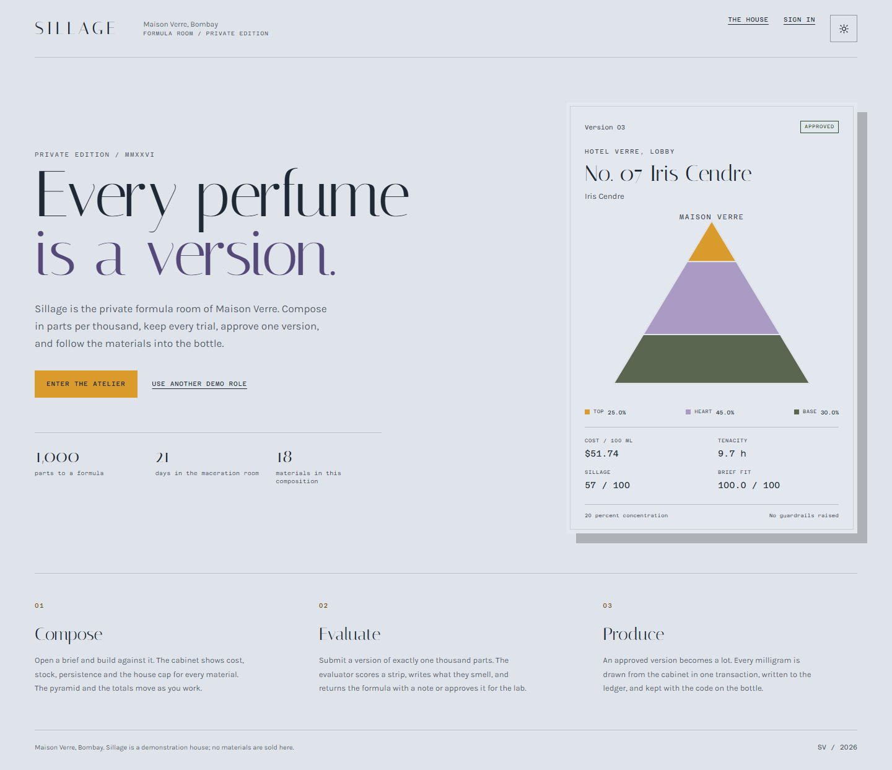
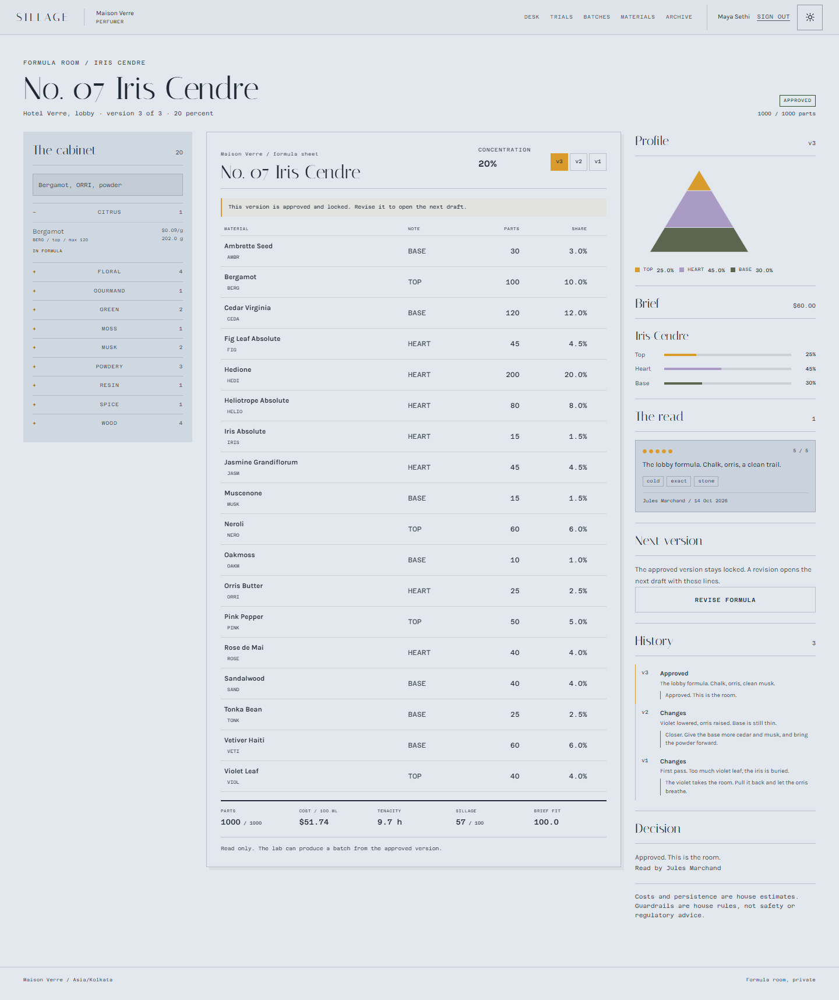
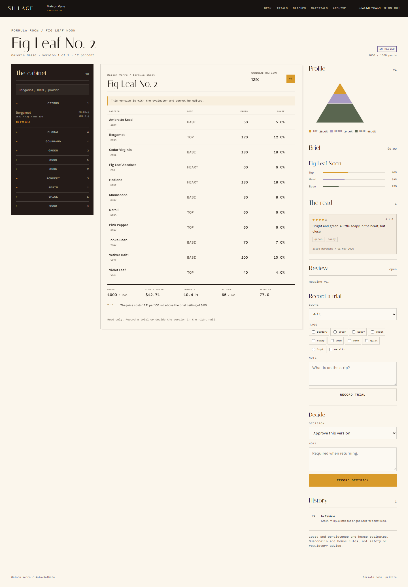
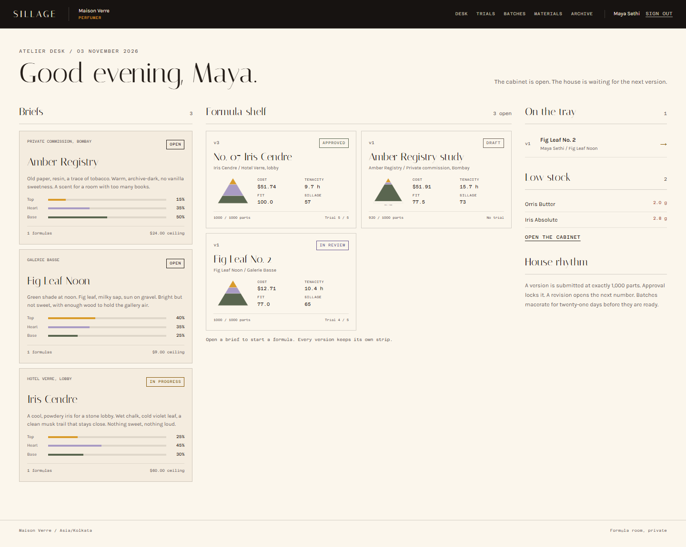
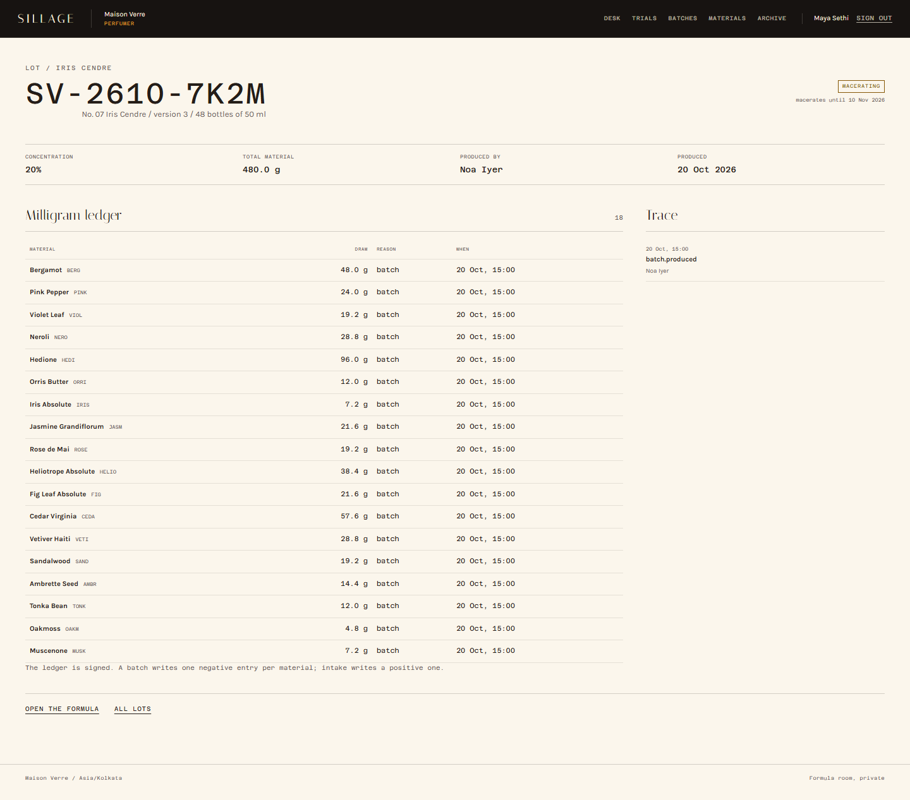

# SILLAGE

A fragrance house's private formula room.

Sillage is a working multi-user atelier for Maison Verre. A perfumer composes a formula in parts per thousand, an evaluator scores trials and approves or returns a version, and the lab produces traceable lots while stock is deducted in one transaction.

[](https://sillage-one-mu.vercel.app)
[](https://github.com/devtechedge/sillage/actions/workflows/ci.yml)
[](https://nextjs.org/)
[](https://www.typescriptlang.org/)
[](LICENSE)



## Live Demo

**https://sillage-one-mu.vercel.app**

> **Status:** demo house, seeded fiction, and a persistent Neon PostgreSQL database. The data resets when the seed is run, not on every visit. The four demo roles are public. Demo access is intentional; do not put real client or commercial data in this deployment.

## The room

A brief sets the target note shares, the material families and the cost ceiling. A formula is a versioned sheet of materials, never a loose sketch. A version becomes `IN_REVIEW` only at exactly 1,000 parts and under every house maximum. Approval locks it forever. A revision copies the lines into the next numbered draft. A batch can only be produced from an approved version, and the draw is written to the material ledger in the same serializable transaction that creates the lot.

The demo house has three briefs, three formulas in different states, four trials, a macerating lot, and two materials below their reorder line.

### Demo accounts

Password for all four: `SillageDemo!2026`

| Role | Email | Can do |
| --- | --- | --- |
| Owner | `owner@sillage.demo` | Everything, members and settings |
| Perfumer | `maya@sillage.demo` | Compose, save drafts, submit, revise |
| Evaluator | `jules@sillage.demo` | Record trials, approve or return |
| Lab | `noa@sillage.demo` | Materials, intake, produce batches |

A fifth account, `rival@sillage.demo`, belongs to another house. It proves tenant scope: every Maison Verre record returns 404.

## Product rules

- A formula is measured in integer parts per thousand. Submission requires exactly 1,000 parts and at least three materials.
- Every material has a house maximum. Approval checks the maxima again, so a version submitted before a cap change cannot slip through.
- Money is integer cents. A 100 ml cost is the concentrate at the chosen concentration, plus fixed packaging.
- Tenacity and sillage are named house heuristics, not measured claims. The interface says so.
- Stock is integer milligrams. A batch rounds each draw up, checks every drawer, and writes one negative ledger entry per material.
- A shortage stops the whole batch. No partial production, no orphan ledger entry.
- Approved versions and trials are immutable. The audit trail records creation, drafts, submissions, returns, approvals, trials, intake and production.
- Every query is scoped by house id. Roles are re-read inside approval and production transactions.

## Screens

| Formula room | Review |
| --- | --- |
|  |  |

| Desk | Lot |
| --- | --- |
|  |  |

Mobile keeps the paper sheet and moves the cabinet below it:


## Stack

- Next.js 16 App Router, React 19, strict TypeScript
- Prisma 7 with the PostgreSQL adapter, Neon Postgres
- Zod 4, server actions, server components
- Session cookies with SHA-256 token hashes, scrypt passwords
- Plain CSS with self-hosted Italiana, Karla and Azeret Mono
- Vitest, Playwright, axe-core
- No third-party auth, email, storage, queue or model provider

## Local setup

Requires Node 22 or newer and a PostgreSQL database.

```bash
npm ci
cp .env.example .env
# set DATABASE_URL, DATABASE_URL_UNPOOLED, SESSION_PEPPER
npx prisma migrate deploy
ALLOW_PROD_SEED=1 npm run db:seed
npm run dev
```

Open http://localhost:3000 and choose a demo role.

### Environment

| Variable | Use |
| --- | --- |
| `DATABASE_URL` | Pooled application connection |
| `DATABASE_URL_UNPOOLED` | Direct migration connection |
| `DATABASE_URL_TEST` | Vitest integration database |
| `DATABASE_URL_TEST_UNPOOLED` | Direct Vitest connection |
| `DATABASE_URL_E2E` | Playwright database |
| `DATABASE_URL_E2E_UNPOOLED` | Direct Playwright connection |
| `SESSION_PEPPER` | Long random secret for session token hashes |
| `NEXT_PUBLIC_SITE_URL` | Canonical site URL |
| `DEMO_MODE` | Set to `0` to close one-click demo entry |
| `ALLOW_PROD_SEED` | Required to seed a database whose name has no test marker |

The seed refuses anything that is not a test database unless `ALLOW_PROD_SEED=1`. Browser and integration test databases must include `test` or `e2e` in the name.

## Commands

```bash
npm run lint
npm run typecheck
npm test              # unit and integration
npm run e2e           # build, seed e2e database, Playwright
npm run build
npm run db:status
```

## Verification

As of 3 November 2026:

- 70 unit tests
- 34 integration tests against real PostgreSQL
- 12 Playwright journeys, including axe scans, role denials, tenant escape, keyboard entry, dark mode persistence, mobile overflow, a full draft to lot journey and the health endpoint
- Production build passes
- Lighthouse: see `docs/lighthouse.md`

The integration suite covers 999, 1,000 and 1,001 parts, cap enforcement, approval immutability, return notes, revision copying, a one milligram shortage rollback, a five-way concurrent batch race, duplicate lot codes and last-owner protection.

## Architecture

```
app/            routes, server actions, API health
components/     paper sheet, cabinet, pyramid, review forms
domain/         pure calculations and lot codes
services/       scoped reads and transactional writes
prisma/         schema, migration and guards
tests/          unit and real-Postgres integration
e2e/            browser journeys and accessibility
scripts/        seed, database preparation, screenshots
```

The domain layer has no React and no database imports. The composer preview and the server use the same functions, so the number on the paper is the number that gets saved.

## Data and privacy

Every name, material, formula, trial and lot is seeded fiction. The demo database is public. Do not put real client or personal data in it.

## License

MIT, Devayan Mandal.
